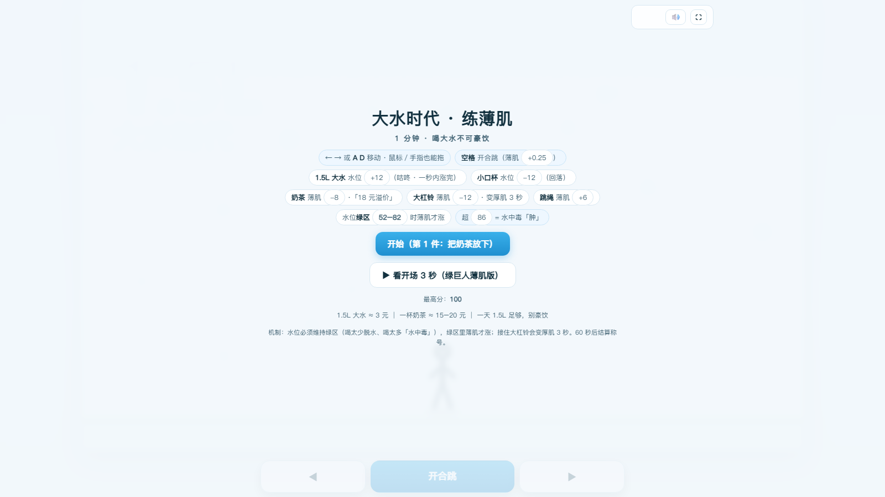
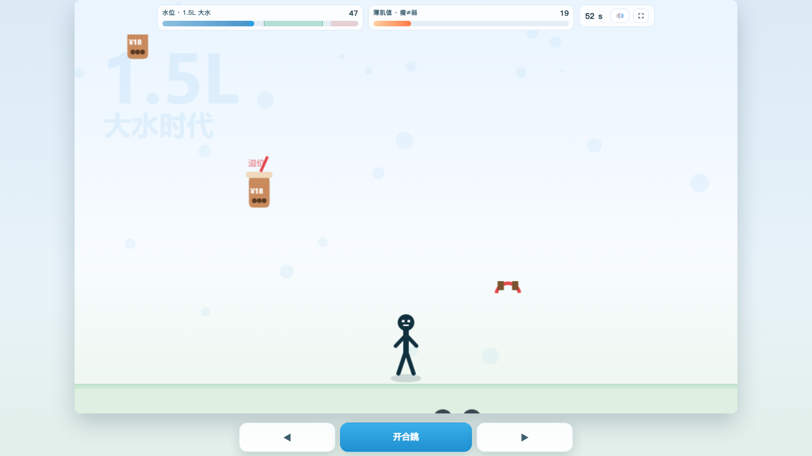
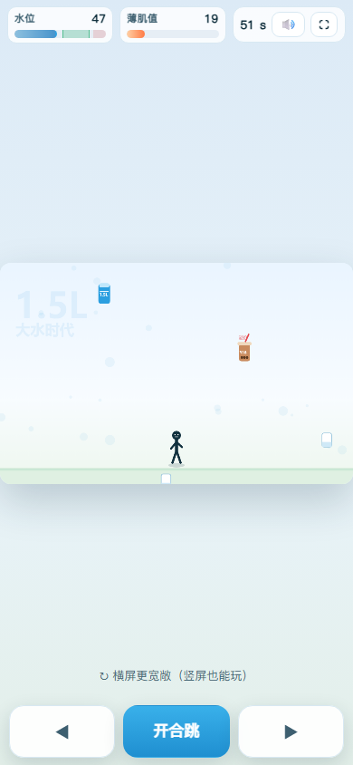
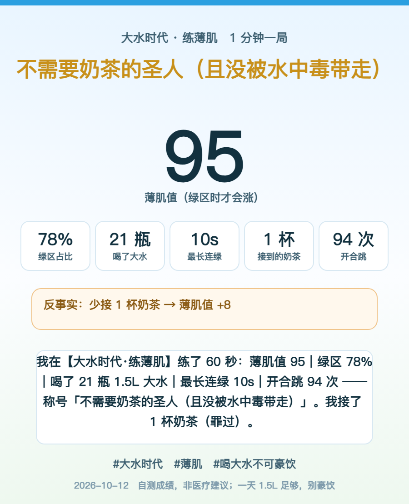

# 大水时代 · 练薄肌

**60 秒一局的「双轴走钢丝」小游戏：一边喝水续命，一边练薄肌。**

> 在线玩：**https://dukewang01.github.io/dashui-shidai/** （铺满全屏，操作按钮悬浮在底部：◀ 开合跳 ▶）
> 或者直接双击 `index.html` —— 单文件、零外部依赖、离线可玩。

---

## 一、玩法：两根轴，一起管

| 轴 | 规则 | 为什么这么设计 |
|---|---|---|
| **水位**（生存轴） | 掉得很快，必须接 **1.5L 大水**续命。绿区 **52–82** 才是安全带；**超 86 → 水中毒「肿」**，血量直掉 | 真新闻梗：*"喝大水不可豪饮"*。玩家一定会先灌爆一次，然后自己笑 |
| **薄肌值**（计分轴） | **只有在水位绿区里才被动增长**。这是唯一的主分 | 两根轴互相拉扯：想练肌就得稳水位，想稳水位就得不停喝 |

**开局先放 3 秒**（可点击跳过，开始页也有「看开场 3 秒」按钮）：绿巨人变身 → 先喝口水 → 上秤 18.6% → 一拳砸秤「楼，还是没砸」。这是《怪物养生图鉴》系列第一集，先把「练薄肌」的梗钉进脑子，再让玩家自己上手。

**掉落物一览**

| 物件 | 效果 | 梗 |
|---|---|---|
| 1.5L 大水 | 水位 **+12**（"咕咚"渐变 1 秒涨完，不是瞬间跳） | 3 块钱的续命刚需 |
| 小口杯 | 水位 **−12** | 喝太急要回落，体会"小口" |
| 奶茶 | 薄肌 **−8** | **18 元溢价刺客**（15–20 元 ≈ 5 瓶大水） |
| 大杠铃 | 薄肌 **−12**，且**变厚肌 3 秒**（人物变宽、被动收益减半） | 惩罚是"变笨重/变丑"，比扣分好笑 |
| 跳绳 | 薄肌 **+6** | 唯一的正收益道具 |
| 空格 / 开合跳键 | 薄肌 **+0.25**，攒连击 | 把"练"做成手感，不是纯等待 |

**60 秒**一局，最后 5 秒进入「**直播间秒杀**」——奶茶暴雨，躲不躲得开决定生死。

---

## 二、称号表（这才是分享欲的来源）

| 薄肌值 | 称号 |
|---|---|
| < 30 | 奶茶刺客的猎物 |
| 30–49 | 普通打工人（还没开始练） |
| 50–65 | 薄肌预备生 |
| 66–79 | 薄肌男孩 / 薄肌女孩 |
| 80–91 | 大水时代的节流冠军 |
| **≥ 92** | **不需要奶茶的圣人（且没被水中毒带走）** ← 金色 |

结算页会给你一句**反事实**（"少接 2 杯奶茶 → 薄肌值 +16；2 次大杠铃让你白掉 24 点"）——后悔药比分数更让人想再来一局。

---

## 三、一键出成绩卡

点「保存成绩卡」直接生成一张 900px 宽的竖版图（发群 / 朋友圈 / 小红书都能用），
布局是 canvas 上按行数自适应的，长称号和长文案都不会溢出。

配套还有一行可复制的文案：
> 我在【大水时代·练薄肌】练了 60 秒：薄肌值 100｜绿区 74%｜喝了 18 瓶 1.5L 大水｜最长连绿 9s｜开合跳 89 次 —— 称号「不需要奶茶的圣人（且没被水中毒带走）」。我接了 1 杯奶茶（罪过）。#大水时代 #薄肌

上面那张就是 100 分局的原图，卡面数字与这段文案一致（机器人 2 倍速打出来的，不是手改的）。

卡片底部还印着**指向本页的二维码**（离线内联矩阵，不依赖任何二维码服务）：截图发出去，别人扫码就能直接开玩——「截图 → 扫码 → 来玩 → 再截图」这一圈闭上，传播才不是只发出去一个分数。文案块左对齐、换行留了标点余量，所以末行不会飘到框中间、标点也不会顶出圆角边框。

---

## 四、设计笔记：我在想什么

1. **不做"躲障碍得分"，做两根互相拉扯的轴。**
   一根轴的游戏，玩家十秒就摸清最优解；两根轴才会出现"我该续水还是该冒险练"的犹豫——犹豫才是游戏。
2. **惩罚不是扣分，而是"变丑"。**
   杠铃扣分只是数字；**人物变厚、肚子鼓起**才有画面笑点。水中毒直接让小人"肿"起来，这比 "HP −20" 好笑十倍。
3. **"咕咚"是刻意的。**
   水位不瞬间跳而是 1 秒涨完，玩家才有"灌下去"的体感，也才有机会**喝过头**——梗要能被玩家亲手试出来，不能只写在说明里。
4. **BGM 用 Web Audio 现算，不带任何音频文件。**
   8-bit 循环（贝斯 + 琶音 + 噪声 hi-hat，Am–F–C–G），**110 → 168 BPM 随难度加速**；音效也是合成的（咕咚 / 叮 / 咚 / 奶茶苦音 / 结算 jingle）。好处：零版权、零外链、离线可玩、仓库里不用塞几 MB 音频。
5. **传播四件套**：① 60 秒一局 ② 称号（有裱褙感）③ 可复制文案 ④ 一键成绩卡。
   一个梗要传起来，必须让玩家**零成本地把"我赢了"发出去**。
6. **最后的奶茶暴雨**：越到后面越翻车，保证"人人都有故事可讲"。

---

## 五、技术上怎么做的

- **单文件 HTML**：内联 CSS/JS，无框架、无 CDN、无字体外链 —— `index.html` 拷到哪都能跑。
- **判定用扫掠 AABB**：初版按"当前帧位置"判断碰撞，高倍速下一帧位移 49px 会直接**飞过** 64px 的接水窗口 —— 改成对移动线段做扫掠检测后，高速与掉帧都不再漏判。
- **可测性**：页面暴露 `window.__game`（内部状态 / 配置 / `saveCard`），配 `?bot=1&speed=N` 跑机器人；配 CDP 自动化脚本截图取证，并且会收集 `window.__errs`（运行时错误的兜底收集）。
- **二维码构建期生成、运行期零依赖**：Python `segno` 出 33×33 矩阵（ECC Q）→ 内联成 0/1 字符串 → canvas 按 **4px 整数模块 + 白底静区**绘制（小数坐标会被抗锯齿糊掉、深色底会吃掉对比度，两种都扫不出来）。验证方式不是"比对矩阵"，而是**把导出的 PNG 拿去真解码**（`cv2.QRCodeDetector` 解出正确网址才算过；`cv2.imread` 读不了中文路径，要用 `numpy + imdecode` 读字节）。
- **开场 3 秒是独立覆盖层 canvas**：自带 rAF 循环、3 秒自动收尾、点击/按键跳过 —— 完全不碰主渲染循环，所以开场出问题也影响不到游戏本体；`?bot=1` 或加 `&nointro` 时自动跳过（否则每次自动化都白等 3 秒、时序断言会漂）；暴露 `__intro.at(ms)` 把任意毫秒定格成图，粒子走固定参数表而非 `Math.random`，同一毫秒每次渲染都一样。
- **成绩卡按"量算 + 流水游标"排版**：所有块高由**行数**算出（`y += 块高 + 间距`），画布总高取最后一个游标 —— 换行多一点就长一点；分享文案块**左对齐**（居中时段落末行会飘到框中间），换行宽度还留了约 40px 余量给「」这类标点粘连（换行规则不让行首出现标点，会把标点挤回上一行、顶出圆角框）。

**机器人实测（2 倍速，同一脚本多局）**

| 打法 | 薄肌值 | 绿区占比 | 称号 |
|---|---|---|---|
| 完全摆烂（一次不动） | **0** | 10% | 奶茶刺客的猎物 |
| 机器人正常打 | 41 / 46 / 68 / **95 / 96 / 100** | 34–86% | 普通打工人 → **圣人** |

*结论：最高档「圣人」的 100 分是**实测可达**的 —— 本页顶部那张卡就是机器人在 2 倍速下打出的 100 分局（74% 绿区、9s 最长连绿、1 次杠铃），不是画在墙上的大饼。*

---

## 六、全屏铺满 + 底部悬浮操作条

上一版是"网页里放一块 960×600 的游戏框"、框下面摆三个手机按钮。这一版把游戏框变成**整个屏幕**，操作按钮**悬浮在屏幕底部**（不占布局空间、也不随画面缩放）。

- **世界等比铺满、绝不拉伸**：游戏逻辑仍固定在 960×600 的坐标系里（一行没改），把这块矩形按 `min(视口宽/960, 可用高/600)` 缩放后居中 —— 宽屏左右留边、窄屏上下留边，画面永不变形。
- **按钮永远不压地面和人物**：布局时先量出悬浮条的真实高度（含 `env(safe-area-inset-bottom)`），**从可用高度里扣掉**再算缩放 —— 世界底边与按钮之间始终留 ~10px，站在地上的人不会被按钮盖住。
- **HUD／面板跟视口、不跟世界缩放**：水位·薄肌面板、开始页、结算页都是 HTML 覆盖层，字号不随世界缩小；世界宽度不足 720px 时 HUD 自动切**紧凑模式**（缩字号、去掉"· 1.5L 大水"这类副标签、隐掉连绿计数）。
- **HUD 高度就是掉落物的裁切线**（`hudCut`）：掉落物从 HUD 下沿才开始可见。所以 HUD 一变高，物件就出现得更晚、反应时间更短 —— `.meter .lbl` 因此强制 `white-space:nowrap`（否则"×N 连绿"一出现，HUD 从 68px 涨到 116px，裁切线跟着跳）。实测整局稳定：桌面 68px→裁切 50、紧凑 54px→裁切 94。
- **竖屏不硬撑**：竖屏时世界比"HUD 到按钮之间"的空区还矮，就居中摆放（裁切线变成 0 = 完全不裁），整幅画面完整可见，留白处提示"横屏更宽敞"；横屏/桌面时世界顶到 0、HUD 浮在天空上（原本就是这设计）。
- **一个真踩到的坑**：面板弹出时原本把整个 HUD 容器 `opacity:0` 淡出 —— 但 `opacity<1` 会生成**层叠上下文**，右侧"静音/全屏"按钮再怎么 `z-index` 也浮不到全屏面板之上，**开始页点不到全屏**（实测点击链只命中面板）。改成只淡出"游戏数据"（水位/薄肌/秒数/连绿），右侧按钮始终可点。验证不靠"看起来在"：`document.elementFromPoint` 命中测试 + 真派发一次鼠标点击，确认 handler 被调用、按钮文案 ⛶→⤡。
- **全屏开关**：右上角 ⛶（快捷键 `F`）走 Fullscreen API；舞台是 `position:fixed` 铺满视口，`fullscreenchange`／`resize`／`orientationchange` 都重算布局，进出全屏不会错位。
- **触控**：◀ / 开合跳 / ▶ 实测 **190×58 / 260×58 / 190×58 px**（≥44px 拇指标准），`touch-action:none` 防误滚，`pointerdown` 直接响应。

**四种视口实测（每格都对过像素）**：桌面 1600×900、平板 1024×600、手机横屏 900×430、手机竖屏 390×844 × 开始页/对局中/结算页 × `window.__errs` 全空；另有 2560×1440、1920×500、360×640 三个极端尺寸 —— 世界与悬浮条均无重叠。

---

## 七、梗与事实边界

- "1.5L 大水 ≈ 3 元 ｜ 一杯奶茶 ≈ 15–20 元" —— 这是梗的"账"，不是精确零售价。
- **自测成绩，非医疗建议；一天 1.5L 足够，别豪饮。**（真新闻里医生也是这么说的）
- 本项目是**玩梗的 Demo**，与任何品牌、平台、机构无关。

---

## 许可

代码随你拿去改（署名不必）。游戏内文案、称号、成绩卡模板属玩梗创作。
